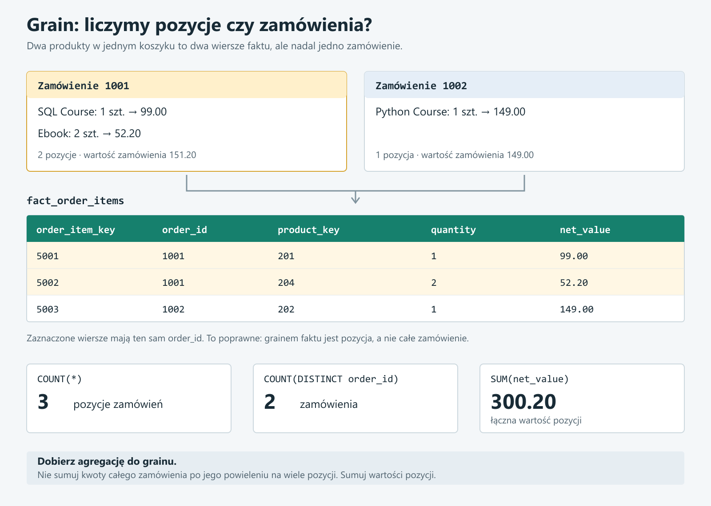
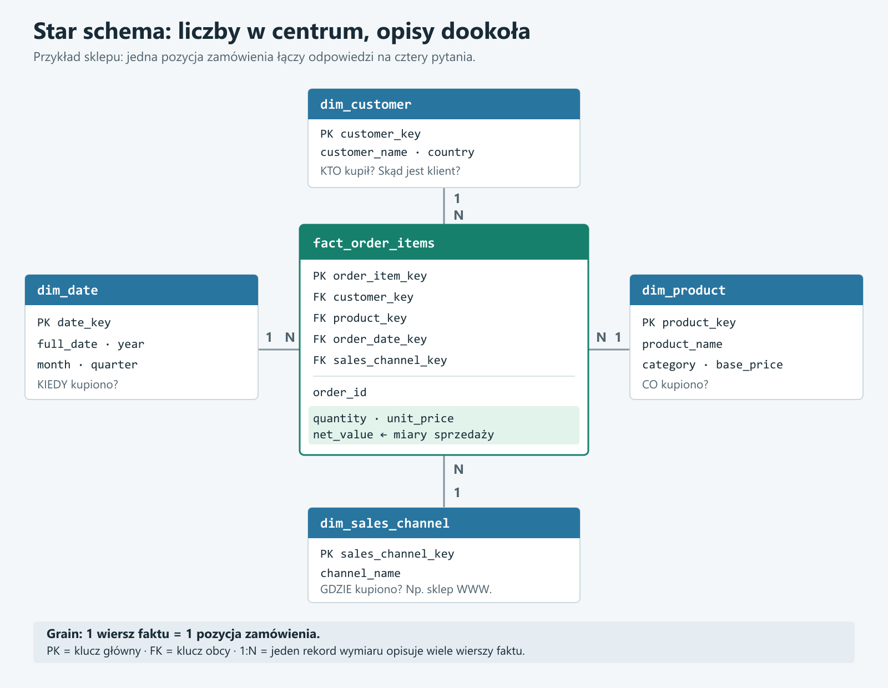
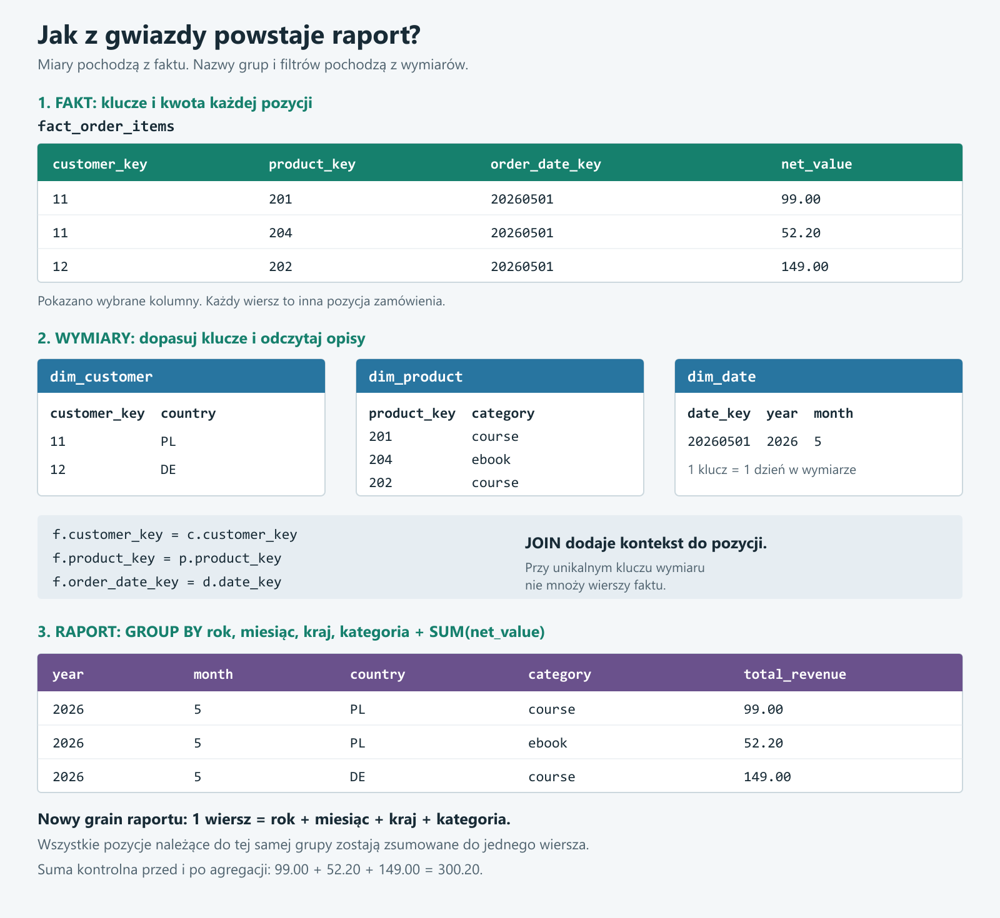

# 05 - Fakty, wymiary i star schema

## Wstep dla osoby po podstawach SQL

Do tej pory znasz tabele takie jak `customers`, `orders`, `products` i `order_items`.

To sa dobre tabele do nauki joinow i agregacji. Ale gdy firma zaczyna budowac raporty, dashboardy i hurtownie danych, czesto uklada dane w specjalny model analityczny.

Ta lekcja odpowiada na pytanie:

```text
Jak ulozyc dane, zeby latwo liczyc sprzedaz, liczbe zamowien, klientow i produkty?
```

Najwazniejsze slowa to:

```text
fakt - zdarzenie i liczby
wymiar - opis i kontekst
grain - co oznacza jeden wiersz
```

Jesli zrozumiesz grain, bedzie Ci znacznie latwiej unikac bledow typu zawyzone `COUNT` albo zdublowane revenue.

## Po co model analityczny?

Tabele aplikacyjne sa dobre dla aplikacji.

Ale raporty czesto potrzebuja innych struktur:

- prostszych do czytania,
- stabilnych definicji metryk,
- mniejszej liczby joinow,
- jasnego grainu,
- wygodnych tabel dla BI i dashboardow.

Dlatego buduje sie modele analityczne.

Po ludzku:

```text
Model analityczny organizuje dane tak, zeby latwo odpowiadac na pytania biznesowe.
```

Przyklad pytania biznesowego:

```text
Ile sprzedalismy w kazdym miesiacu, per kraj klienta i kategorie produktu?
```

Da sie to policzyc z tabel aplikacyjnych, ale przy wielu raportach wygodniej miec model analityczny.

## Model aplikacyjny vs model analityczny

Model aplikacyjny moze miec:

```text
customers
orders
order_items
products
payments
```

Model analityczny moze miec:

```text
fact_order_items
dim_customer
dim_product
dim_date
dim_sales_channel
```

Różnica:

- model aplikacyjny pomaga aplikacji zapisywac operacje,
- model analityczny pomaga liczyc metryki i robic raporty.

## Tabela faktow

Tabela faktow przechowuje mierzalne zdarzenia.

Po ludzku:

```text
Fakt to cos, co sie wydarzylo i co da sie policzyc.
```

Przyklady faktow:

- pozycja zamowienia,
- platnosc,
- zwrot,
- klikniecie,
- wyswietlenie strony,
- wejscie uzytkownika do aplikacji,
- przejazd taksowka,
- pomiar temperatury.

W e-commerce bardzo naturalnym faktem jest:

```text
fact_order_items
```

bo pozycja zamowienia ma konkretne liczby:

- ile sztuk kupiono,
- jaka byla cena,
- jaki byl rabat,
- jaka byla wartosc netto.

## Co zwykle ma tabela faktow?

Tabela faktow zwykle ma:

- klucze do wymiarow,
- date albo czas zdarzenia,
- miary liczbowe,
- czasem identyfikatory zrodlowe do audytu.

Przyklad:

```text
fact_order_items
```

moze miec kolumny:

- `order_item_key`,
- `order_id`,
- `customer_key`,
- `product_key`,
- `order_date_key`,
- `sales_channel_key`,
- `quantity`,
- `unit_price`,
- `gross_value`,
- `discount_value`,
- `net_value`.

## Miary

Miary to liczby, ktore analizujemy albo agregujemy.

Przyklady miar:

- `quantity`,
- `unit_price`,
- `gross_value`,
- `discount_value`,
- `net_value`,
- `payment_amount`,
- `orders_count`.

Typowe agregacje:

```sql
SUM(net_value)
AVG(unit_price)
COUNT(order_id)
COUNT(DISTINCT customer_key)
```

## Miary addytywne, poladdytywne i nieaddytywne

Nie wszystkie miary zachowuja sie tak samo.

### Miary addytywne

Mozna je bezpiecznie sumowac po wielu wymiarach.

Przyklady:

- `quantity`,
- `gross_value`,
- `discount_value`,
- `net_value`.

Przyklad:

```text
Mozemy sumowac net_value po dniach, krajach, produktach i klientach.
```

### Miary poladdytywne

Mozna je sumowac po niektorych wymiarach, ale nie po wszystkich.

Przyklad:

```text
stan magazynu
```

Mozesz sumowac stan magazynu po produktach, ale sumowanie po dniach czesto nie ma sensu.

### Miary nieaddytywne

Nie powinno sie ich prosto sumowac.

Przyklady:

- procent,
- ratio,
- average order value,
- conversion rate.

Zamiast sumowac procenty, zwykle liczysz je ponownie z licznika i mianownika.

Przyklad:

```text
AOV = revenue / orders_count
```

Nie sumujesz AOV z wielu dni. Liczysz:

```text
SUM(revenue) / SUM(orders_count)
```

## Grain tabeli faktow

Grain tabeli faktow to odpowiedz na pytanie:

```text
co oznacza jeden wiersz w tabeli faktow?
```

Przyklad:

```text
fact_order_items: jeden wiersz = jedna pozycja zamowienia
```

To jest najwazniejsza decyzja przy projektowaniu faktu.

Nie tworzymy tabeli faktow, dopoki nie umiemy powiedziec jej grainu jednym zdaniem.

## Dlaczego grain jest tak wazny?

Bo grain decyduje:

- jak liczyc metryki,
- jak robic joiny,
- czy powstana duplikaty,
- czy raport bedzie poprawny,
- czy `COUNT` i `SUM` maja sens.

Przyklad problemu:

Jesli tabela ma jeden wiersz na zamowienie, to:

```text
COUNT(order_id)
```

liczy zamowienia.

Ale jesli tabela ma jeden wiersz na pozycje zamowienia, to:

```text
COUNT(order_id)
```

moze zawyzyc liczbe zamowien, bo jedno zamowienie ma kilka pozycji.

Wtedy trzeba uzyc:

```sql
COUNT(DISTINCT order_id)
```

## Przyklad dobrego grainu

```text
fact_order_items
```

Grain:

```text
jeden wiersz = jedna pozycja zamowienia
```

Przyklad danych:

```text
order_id | product_id | quantity | net_value
1001     | 101        | 1        | 99.00
1001     | 104        | 2        | 52.20
1002     | 102        | 1        | 149.00
```

Tu zamowienie `1001` wystepuje dwa razy, bo ma dwie pozycje.

To jest poprawne, jesli jasno wiemy, ze grain to pozycja zamowienia.

### Zobacz grain na konkretnym zamowieniu



Czytaj obrazek od gory do dolu:

1. Klient sklada zamowienie `1001`, w ktorym kupuje kurs SQL i ebook. Sa to dwie rozne pozycje zamowienia.
2. Drugie zamowienie, `1002`, zawiera jedna pozycje: kurs Pythona.
3. Do `fact_order_items` trafiaja trzy wiersze, a nie dwa. Kazda pozycja dostaje osobny `order_item_key`.
4. `quantity = 2` przy ebooku oznacza dwie sztuki na jednej pozycji, a nie dwa osobne wiersze faktu.

Dlatego dla tego przykladu:

| Co chcemy policzyc? | Wyrazenie | Wynik |
|---|---|---|
| Liczba pozycji zamowien | `COUNT(*)` | `3` |
| Liczba zamowien | `COUNT(DISTINCT order_id)` | `2` |
| Liczba sprzedanych sztuk | `SUM(quantity)` | `4` |
| Laczna wartosc sprzedazy | `SUM(net_value)` | `300.20` |

`net_value` na ilustracji jest wartoscia calej pozycji, juz uwzgledniajaca liczbe sztuk. Dlatego nie mnozymy jej ponownie przez `quantity`.

Na ilustracji uzywamy technicznego `product_key`, a w poprzedniej tabelce zrodlowego `product_id`. Przykladowo produkt z `product_id = 101` otrzymal w wymiarze `product_key = 201`. To dwa identyfikatory tego samego produktu w roznych warstwach, nie wymog, zeby ich wartosci byly takie same.

## Tabela wymiarow

Tabela wymiarow przechowuje opisowy kontekst.

Po ludzku:

```text
Wymiar mowi, kto, co, gdzie, kiedy albo jaki typ.
```

Przyklady wymiarow:

- `dim_customer`,
- `dim_product`,
- `dim_date`,
- `dim_country`,
- `dim_sales_channel`,
- `dim_payment_method`.

Wymiary odpowiadaja na pytania:

- kto kupil?
- co kupil?
- kiedy kupil?
- w jakim kraju?
- przez jaki kanal?
- jaka byla kategoria produktu?

## Przyklad wymiaru klienta

```text
dim_customer
```

moze miec:

- `customer_key`,
- `customer_id`,
- `customer_name`,
- `email`,
- `country`,
- `signup_date`,
- `acquisition_channel`.

`customer_key` to klucz techniczny w wymiarze.

`customer_id` to identyfikator klienta ze zrodla.

## Przyklad wymiaru produktu

```text
dim_product
```

moze miec:

- `product_key`,
- `product_id`,
- `product_name`,
- `category`,
- `base_price`.

Dzieki temu fakt nie musi przechowywac nazwy produktu w kazdym wierszu.

Fakt przechowuje:

```text
product_key
```

A opis produktu mieszka w:

```text
dim_product
```

## Dim date

`dim_date` to specjalny wymiar daty.

Moze miec:

- `date_key`,
- `full_date`,
- `year`,
- `quarter`,
- `month`,
- `month_name`,
- `week`,
- `day_of_week`,
- `is_weekend`.

Po co?

Bo raporty bardzo czesto analizuja dane po czasie.

Przyklad:

```text
sprzedaz per miesiac
sprzedaz per kwartal
sprzedaz weekday vs weekend
```

## Star schema

Jesli chcesz najpierw uporzadkowac oznaczenia `1:N` i sposob laczenia tabel, przeczytaj [lekcje o relacjach jeden do jednego, jeden do wielu i wiele do wielu](10_relacje_miedzy_tabelami.md). Przyklady bazuja na znanych tabelach `customers`, `orders`, `order_items` i `products`.

Star schema to model:

```text
w centrum tabela faktow
dookola tabele wymiarow
```



### Jak czytac ten diagram?

Zielona tabela w centrum to fakt. Jeden jej wiersz opisuje jedna pozycje zamowienia. Przechowuje miary, np. `quantity` i `net_value`, oraz klucze wskazujace opisy w wymiarach.

Niebieskie tabele to wymiary. Nie przechowuja tutaj kolejnych pozycji zamowienia, tylko informacje potrzebne do ich opisania:

| Wymiar | Pytanie biznesowe | Przykladowe informacje |
|---|---|---|
| `dim_customer` | Kto kupil? | nazwa klienta, kraj |
| `dim_product` | Co kupiono? | nazwa produktu, kategoria |
| `dim_date` | Kiedy kupiono? | dzien, miesiac, rok |
| `dim_sales_channel` | Gdzie kupiono? | sklep WWW, aplikacja mobilna |

`PK` oznacza klucz glowny: identyfikuje konkretny wiersz tabeli. `FK` oznacza klucz obcy: wskazuje wiersz w powiazanej tabeli.

Oznaczenia `1` i `N` przy polaczeniach czytamy jako **jeden do wielu**. Jeden produkt w `dim_product` moze zostac kupiony na wielu pozycjach zamowien. Kazda taka pozycja wskazuje przez `product_key` jeden konkretny wiersz wymiaru produktu.

Na przyklad `product_key = 201` moze wystepowac w tysiacach wierszy faktu, ale w `dim_product` ten klucz glowny wystepuje tylko raz. Dzieki temu JOIN po tym kluczu dodaje opis produktu, a nie powiela pozycji zamowienia.

W tym modelu `order_date_key` w fakcie wskazuje `date_key` w `dim_date`. Nazwy kolumn nie musza byc identyczne. Wazne, zeby wartosci i znaczenie kluczy do siebie pasowaly.

Kanal sprzedazy to nie to samo co `acquisition_channel` klienta. Klient mogl trafic do firmy przez newsletter, ale dokonac zakupu w aplikacji mobilnej. Pierwsza informacja opisuje pozyskanie klienta, druga konkretna sprzedaz.

Tabela faktow jest w centrum, bo przechowuje zdarzenia i miary.

Tabele wymiarow sa dookola, bo opisuja te zdarzenia.

## Dlaczego to sie nazywa star schema?

Bo diagram przypomina gwiazde:

- fakt jest w srodku,
- wymiary sa promieniami dookola.

Przyklad:

```text
fact_order_items
```

laczy sie z:

```text
dim_customer
dim_product
dim_date
dim_sales_channel
```

## Jak wyglada zapytanie ze star schema?

Przyklad:

```sql
SELECT
    d.year,
    d.month,
    c.country,
    p.category,
    SUM(f.net_value) AS total_revenue
FROM star.fact_order_items f
JOIN star.dim_date d
    ON f.order_date_key = d.date_key
JOIN star.dim_customer c
    ON f.customer_key = c.customer_key
JOIN star.dim_product p
    ON f.product_key = p.product_key
GROUP BY
    d.year,
    d.month,
    c.country,
    p.category;
```

To jest klasyczne pytanie analityczne:

```text
ile sprzedalismy per miesiac, kraj i kategorie?
```

### Od pozycji zamowienia do gotowego raportu



Ilustracja pokazuje logike poprzedniego zapytania na malym zestawie danych. To przyklad modelu do zbudowania, a nie zalozenie, ze schemat `star` jest juz utworzony w Twojej bazie.

1. **Zaczynamy od faktu.** Widzimy klucze i kwoty, ale sam `customer_key = 11` nie mowi jeszcze, z jakiego kraju jest klient.
2. **JOIN dodaje kontekst.** Wymiar klienta pozwala odczytac kraj, wymiar produktu kategorie, a wymiar daty rok i miesiac. Nie laczymy wymiarow ze soba: kazdy dolaczamy do faktu po odpowiednim kluczu.
3. **GROUP BY wyznacza grupy raportu.** Wszystkie pozycje z tym samym rokiem, miesiacem, krajem i kategoria trafiaja do jednej grupy. `SUM(f.net_value)` liczy ich laczna wartosc.

Przed agregacja grain to **jedna pozycja zamowienia**. Po agregacji grain wyniku to **jeden miesiac danego roku + kraj + kategoria**. To juz nie jest lista pojedynczych zakupow.

W malym przykladzie na ilustracji kazda z trzech pozycji trafia do innej grupy. Gdybysmy dodali kolejna pozycje z maja 2026, z kraju `PL` i kategorii `course`, jej wartosc powiekszylaby istniejacy wiersz raportu dla tej grupy.

Suma kontrolna wynosi `300.20` przed agregacja i po niej. Przy pokazanych JOIN-ach kazdy klucz faktu ma dokladnie jedno dopasowanie w wymiarze. Brak dopasowania przy `INNER JOIN` usunalby pozycje z raportu, a nieunikalne dopasowania moglyby zawyzyc sume.

## Natural key i surrogate key

`Natural key` to klucz ze zrodla.

Przyklad:

```text
source.customers.customer_id
```

`Surrogate key` to sztuczny klucz techniczny w modelu analitycznym.

Przyklad:

```text
dim_customer.customer_key
```

Po co surrogate key?

- daje kontrole w modelu analitycznym,
- pomaga przy historii zmian wymiaru,
- oddziela model analityczny od systemu zrodlowego,
- pozwala miec kilka wersji tego samego klienta w czasie.

Na poczatku najwazniejsze:

```text
natural key pochodzi ze zrodla, surrogate key tworzymy w hurtowni/modelu analitycznym
```

## Fact table vs mart

Tabela faktow nie zawsze jest tym samym co mart.

Fakt:

```text
szczegolowe zdarzenia i miary
```

Mart:

```text
gotowa tabela pod konkretny raport albo dashboard
```

Przyklad:

```text
fact_order_items
```

ma jeden wiersz na pozycje zamowienia.

```text
mart.daily_sales_summary
```

ma jeden wiersz na dzien + kraj + kanal.

Fakt jest zwykle bardziej szczegolowy.

Mart jest zwykle bardziej gotowy do konsumpcji.

## Typowe bledy

### Blad 1: brak grainu

Zle:

```text
Tworze fact_sales, ale nie wiem, co oznacza jeden wiersz.
```

Dobrze:

```text
fact_order_items: jeden wiersz = jedna pozycja zamowienia
```

### Blad 2: mieszanie grainow

Zle:

```text
w jednej tabeli sa wiersze per order i per order_item
```

To utrudnia agregacje i prowadzi do bledow.

### Blad 3: liczenie zamowien na grainie pozycji

Jesli fakt jest per pozycja zamowienia:

```sql
COUNT(order_id)
```

moze zawyzac liczbe zamowien.

Bezpieczniej:

```sql
COUNT(DISTINCT order_id)
```

### Blad 4: trzymanie opisow w fakcie bez potrzeby

Jesli w kazdym wierszu faktu trzymasz `product_name`, `category`, `customer_name`, tabela robi sie duza i trudniejsza do utrzymania.

Czesto lepiej przeniesc opisy do wymiarow.

## Dlaczego star schema jest przydatna?

Bo pomaga:

- pilnowac grainu,
- liczyc metryki spójnie,
- budowac raporty,
- oddzielic fakty od opisow,
- zmniejszyc powtarzanie logiki w dashboardach,
- ulatwic prace BI,
- poprawic czytelnosc modelu.

## Najwazniejsze

Tabela faktow odpowiada na pytanie:

```text
co sie wydarzylo i ile?
```

Tabela wymiarow odpowiada na pytanie:

```text
kto, co, kiedy, gdzie, jaki typ?
```

Grain odpowiada na pytanie:

```text
co oznacza jeden wiersz?
```

Star schema odpowiada na pytanie:

```text
jak ulozyc fakty i wymiary, zeby latwo analizowac dane?
```

## Mini sciaga

| Pojecie | Znaczenie |
|---|---|
| Fakt | mierzalne zdarzenie |
| Miara | liczba w fakcie, np. `net_value` |
| Wymiar | opisowy kontekst, np. klient lub produkt |
| Grain | znaczenie jednego wiersza |
| Star schema | fakt w centrum, wymiary dookola |
| Natural key | klucz ze zrodla |
| Surrogate key | sztuczny klucz w modelu analitycznym |
| Dim date | wymiar daty do analiz czasu |

## Co musisz umiec po tej lekcji?

Powinienes umiec:

- wyjasnic czym jest tabela faktow,
- wyjasnic czym jest tabela wymiarow,
- podac grain `fact_order_items`,
- powiedziec dlaczego grain jest wazny,
- rozroznic natural key i surrogate key,
- narysowac prosta star schema,
- napisac proste zapytanie laczace fakt z wymiarami.
