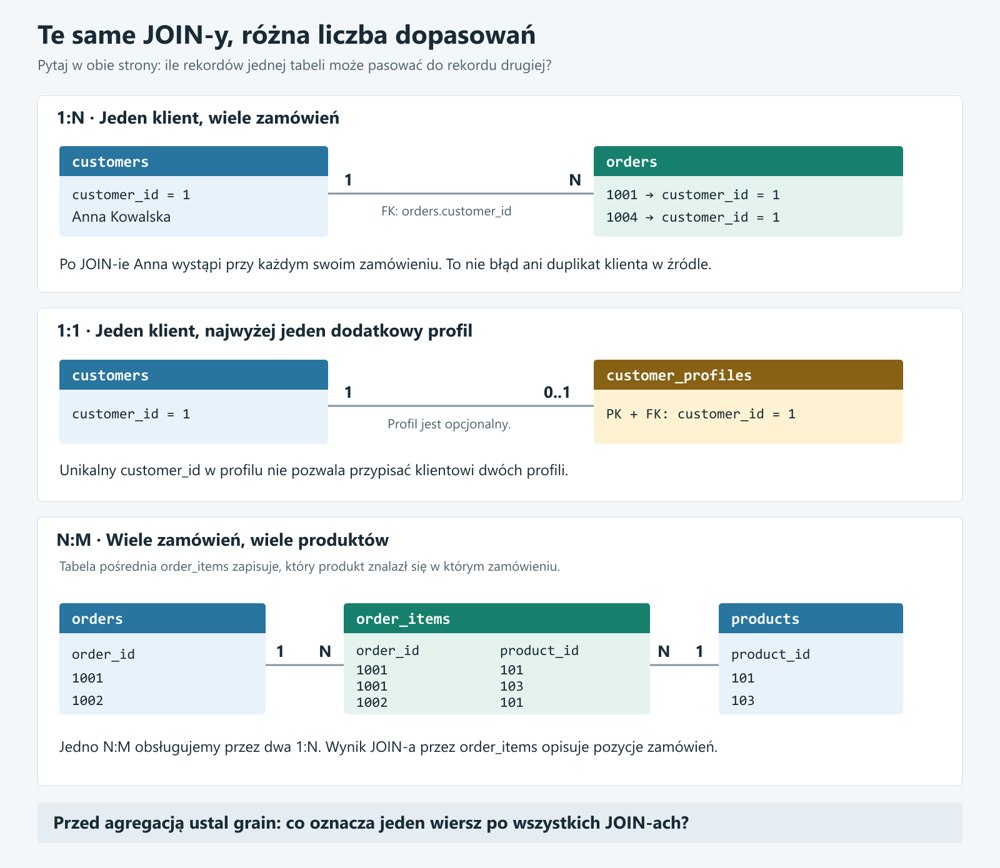

# 10 - Relacje miedzy tabelami: 1:1, 1:N i N:M

## Wstep: znasz juz JOIN, teraz nazwijmy to, co laczysz

Do tej pory laczylismy tabele takim zapytaniem:

```sql
SELECT
    c.customer_id,
    c.customer_name,
    o.order_id,
    o.total_amount
FROM course.customers c
JOIN course.orders o
    ON c.customer_id = o.customer_id
ORDER BY c.customer_id, o.order_id;
```

Wiesz juz, ze `ON` okresla warunek dopasowania wierszy. Teraz zadajmy inne pytanie:

```text
Ile zamowien moze pasowac do jednego klienta?
Ilu klientow moze pasowac do jednego zamowienia?
```

Odpowiedzi opisuja **relacje miedzy tabelami**. Nie jest to nowy rodzaj JOIN-a. To wiedza o tym, jak dane sa ze soba powiazane i ile dopasowan moze powstac.

Po tej lekcji masz umiec przewidziec wynik JOIN-a przed jego wykonaniem i sprawdzic, czy agregujesz na odpowiednim grainie.

## Mapa trzech relacji



Litera `N` oznacza wiele, a nie konkretna liczbe. Zapis `1:N` czytamy jako jeden do wielu. Przy relacji wiele do wielu mozna spotkac zarowno `N:M`, jak i `M:N`.

Diagram pokazuje maksymalna liczbe powiazan. Osobno trzeba ustalic, czy rekord moze nie miec zadnego powiazania. Na przyklad klient moze miec zero zamowien.

## Relacja to nie to samo co INNER JOIN albo LEFT JOIN

To dwa rozne pytania:

| Pytanie | O czym decyduje? |
|---|---|
| Jaka jest relacja: `1:1`, `1:N`, `N:M`? | Ile rekordow moze byc ze soba powiazanych? |
| Jaki JOIN wybieram? | Czy zachowac rekordy bez dopasowania? |

Relacje `customers` - `orders` mozna odczytywac przez `INNER JOIN` albo `LEFT JOIN`. Wybor JOIN-a nie zmienia tego, ze jeden klient moze zlozyc wiele zamowien.

## 1. Jeden do wielu: customers - orders

### Najpierw sytuacja biznesowa

Anna zalozyla konto w sklepie. W poniedzialek kupila kurs SQL, a w piatek szablon dashboardu. Ma jedno konto klienta, ale dwa zamowienia.

W naszym modelu:

- jeden klient moze miec wiele zamowien,
- kazde zamowienie nalezy do jednego klienta,
- klient moze jeszcze nie miec zadnego zamowienia.

Zapisujemy to tak:

```text
customers (1) -------- (N) orders
```

Czytajac od drugiej strony, jest to relacja **wiele do jednego**: wiele zamowien wskazuje jednego klienta. To ta sama relacja, tylko ogladana z innej strony.

### Gdzie zapisujemy powiazanie?

W tabeli `customers` kluczem glownym jest `customer_id`. W tabeli `orders` kolumna `customer_id` jest kluczem obcym.

```text
customers
customer_id | customer_name
1           | Anna Kowalska
2           | Jan Nowak

orders
order_id | customer_id | total_amount
1001     | 1           | 169.99
1004     | 1           | 79.00
1002     | 2           | 120.00
```

To ilustracyjny fragment danych, nie pelna zawartosc tabel kursowych.

`customer_id = 1` wystepuje raz w `customers`, ale moze wystepowac wiele razy w `orders`. Nie zapisujemy w kliencie listy typu `1001,1004`. Kazde zamowienie w osobnym wierszu wskazuje swojego klienta.

### Co wymusza klucz obcy?

W kursowej tabeli `orders` mamy:

```sql
customer_id INT NOT NULL,
CONSTRAINT fk_orders_customers
    FOREIGN KEY (customer_id)
    REFERENCES course.customers(customer_id)
```

To fragment definicji tabeli, nie samodzielne polecenie do uruchomienia.

- `FOREIGN KEY` sprawdza, czy wskazany klient istnieje.
- `NOT NULL` nie pozwala zapisac zamowienia bez identyfikatora klienta.
- Klucz glowny `customers.customer_id` sprawia, ze identyfikator wskazuje co najwyzej jednego klienta.
- Brak `UNIQUE` na `orders.customer_id` pozwala temu samemu klientowi miec wiele zamowien.

Sam klucz obcy nie ogranicza klienta do jednego zamowienia. Nie gwarantuje tez, ze kazdy klient zlozy zamowienie.

### Co robi JOIN krok po kroku?

W zapytaniu z poczatku lekcji warunek brzmi:

```sql
ON c.customer_id = o.customer_id
```

Dla Anny pasuja dwa zamowienia z pokazanej probki. Wynik zawiera wiec dwa wiersze:

```text
customer_id | customer_name  | order_id | total_amount
1           | Anna Kowalska  | 1001     | 169.99
1           | Anna Kowalska  | 1004     | 79.00
2           | Jan Nowak      | 1002     | 120.00
```

Anna nie zostala zdublowana w tabeli `customers`. Jej dane powtarzaja sie **w wyniku zapytania**, poniewaz pokazujemy ja obok kazdego jej zamowienia.

Grain tego wyniku to **jedno zamowienie**, a nie jeden klient. Przy naszych ograniczeniach kazde zamowienie ma dokladnie jednego pasujacego klienta.

### Jak wrocic do jednego wiersza na klienta?

Jesli raport ma pokazywac wszystkich klientow wraz z liczba zamowien:

```sql
SELECT
    c.customer_id,
    c.customer_name,
    COUNT(o.order_id) AS orders_count,
    COALESCE(SUM(o.total_amount), 0) AS total_revenue
FROM course.customers c
LEFT JOIN course.orders o
    ON c.customer_id = o.customer_id
GROUP BY c.customer_id, c.customer_name
ORDER BY total_revenue DESC, c.customer_id;
```

`LEFT JOIN` zachowuje klienta bez zamowien. `GROUP BY` zbiera wszystkie wiersze danego klienta w jedna grupe. Grain wyniku to teraz **jeden klient**.

Liczymy `COUNT(o.order_id)`, nie `COUNT(*)`. Dla klienta bez zamowien `LEFT JOIN` utworzy jeden wiersz z `NULL` po stronie zamowienia. `COUNT(*)` policzylby go jako `1`, a `COUNT(o.order_id)` zwroci poprawne `0`.

W tym raporcie sumujemy zamowienia wszystkich statusow. Gdy interesuje nas tylko oplacona sprzedaz, dla zachowania klientow bez takich zamowien dodajemy `AND o.status = 'paid'` do `ON`. Umieszczenie `o.status = 'paid'` w `WHERE` odrzuciloby klientow bez dopasowania.

## 2. Jeden do jednego: klient i opcjonalny profil

### Po co rozdzielac dane na dwie tabele?

Wyobraz sobie, ze dane konta trzymamy w `customers`, a dodatkowe ustawienia klienta w `customer_profiles`.

Jeden klient moze miec najwyzej jeden taki profil. Jeden profil nalezy do jednego klienta.

```text
customers (1) -------- (0..1) customer_profiles
```

Nazywamy to opcjonalna relacja jeden do jednego. Zapis `0..1` dopowiada wazny szczegol: profil nie musi jeszcze istniec.

**`customer_profiles` to dodatkowa tabela demonstracyjna. Nie nalezy do czterech podstawowych tabel kursowych.** Jej utworzenie jest potrzebne tylko wtedy, gdy chcesz uruchomic ten przyklad:

```sql
CREATE TABLE course.customer_profiles (
    customer_id INT PRIMARY KEY,
    preferred_language VARCHAR(10) NOT NULL,
    marketing_consent BOOLEAN NOT NULL DEFAULT FALSE,
    CONSTRAINT fk_customer_profiles_customers
        FOREIGN KEY (customer_id)
        REFERENCES course.customers(customer_id)
);
```

Nie uruchamiaj `CREATE TABLE` ponownie, jezeli taka tabela juz istnieje. Ten fragment nie dodaje ani nie zmienia danych w `customers`.

Po pierwszym utworzeniu tabeli mozesz dodac profil dla jednego istniejacego klienta:

```sql
INSERT INTO course.customer_profiles (
    customer_id,
    preferred_language,
    marketing_consent
)
SELECT
    customer_id,
    'pl',
    FALSE
FROM course.customers
ORDER BY customer_id
LIMIT 1;
```

`SELECT` wybiera klienta z najmniejszym identyfikatorem, a `INSERT INTO ... SELECT` tworzy dla niego profil. Pozostali klienci nadal nie maja profilu. Przy pustej tabeli `customers` nie zostanie dodany zaden wiersz. Ponowne wykonanie INSERT-a dla tego samego klienta zostanie odrzucone przez klucz glowny: to wlasnie ograniczenie relacji do jednego profilu.

### Dlaczego to jeden do jednego, a nie jeden do wielu?

Kolumna `customer_profiles.customer_id` pelni dwie role:

- jako `FOREIGN KEY` wskazuje istniejacego klienta,
- jako `PRIMARY KEY` nie moze sie powtarzac ani byc `NULL`.

Nie da sie wiec dodac dwoch profili z tym samym `customer_id`. W relacji jeden do wielu klucz obcy mogl sie powtarzac; tutaj ograniczenie unikalnosci to blokuje.

Inny poprawny wariant to osobny `profile_id` jako klucz glowny oraz `customer_id INT NOT NULL UNIQUE` jako klucz obcy. `UNIQUE` ogranicza liczbe profili klienta do jednego.

### Znany JOIN, inne ograniczenie liczby dopasowan

```sql
SELECT
    c.customer_id,
    c.customer_name,
    cp.preferred_language,
    cp.marketing_consent
FROM course.customers c
LEFT JOIN course.customer_profiles cp
    ON c.customer_id = cp.customer_id
ORDER BY c.customer_id;
```

Kazdy klient dostaje najwyzej jeden pasujacy profil. `LEFT JOIN` zachowuje takze klientow bez profilu i pokazuje im `NULL` w kolumnach `cp`.

Grain pozostaje **jeden klient**. Ten JOIN nie zwieksza liczby wierszy wzgledem `customers`, bo klucz po prawej stronie jest unikalny.

Wazne: taki model nie wymusza, ze kazdy klient musi miec profil. Wymusza tylko, ze istniejacy profil wskazuje klienta i ze klient nie ma dwoch profili. Gwarancja istnienia profilu dla kazdego klienta wymagalaby dodatkowego mechanizmu lub innego projektu danych.

Nie rozbijamy tabel na relacje `1:1` bez powodu. Taki podzial moze miec sens np. dla opcjonalnych danych lub wydzielenia danych z innymi uprawnieniami dostepu.

## 3. Wiele do wielu: orders - products

### Znasz te relacje, nawet jesli nie znasz jeszcze nazwy

Zadaj dwa pytania:

```text
Czy jedno zamowienie moze zawierac wiele produktow? Tak.
Czy ten sam produkt moze pojawic sie w wielu zamowieniach? Tak.
```

To relacja **wiele do wielu**:

```text
orders (N) -------- (M) products
```

Zamowienie `1001` moze zawierac kurs SQL i ebook. Ten sam kurs SQL moze tez pojawic sie w zamowieniu `1002`.

Nie da sie opisac wszystkich takich powiazan pojedyncza kolumna `product_id` w `orders`, jesli kazdy wiersz ma nadal oznaczac jedno zamowienie. Taka kolumna pomiescilaby tylko jeden produkt.

### Co robimy? Dodajemy tabele posrednia

W kursie ta tabela juz istnieje: **`order_items`**.

```text
orders (1) ---- (N) order_items (N) ---- (1) products
```

Zamiast jednego bezposredniego polaczenia wiele do wielu mamy dwa polaczenia jeden do wielu:

- jedno zamowienie ma wiele pozycji,
- jeden produkt moze wystapic na wielu pozycjach,
- jedna pozycja wskazuje jedno zamowienie i jeden produkt.

Przykladowe wiersze z kursowych danych:

```text
order_item_id | order_id | product_id | quantity | unit_price
1             | 1001     | 101        | 1        | 120.00
2             | 1001     | 103        | 1        | 49.99
3             | 1002     | 101        | 1        | 120.00
```

Pierwszy wiersz znaczy: na pozycji `1` zamowienia `1001` kupiono jedna sztuke produktu `101` po `120.00`.

Tabela posrednia nie musi zawierac samych kluczy. W `order_items` przechowujemy tez `quantity` i `unit_price`, bo dotycza konkretnego zakupu. Cena w katalogu produktu moze pozniej sie zmienic, a cena na historycznej pozycji zamowienia powinna nadal opisywac ten zakup.

### JOIN przez tabele posrednia

```sql
SELECT
    o.order_id,
    oi.order_item_id,
    p.product_id,
    p.product_name,
    oi.quantity,
    oi.unit_price,
    oi.quantity * oi.unit_price AS line_value
FROM course.orders o
JOIN course.order_items oi
    ON oi.order_id = o.order_id
JOIN course.products p
    ON p.product_id = oi.product_id
ORDER BY o.order_id, oi.order_item_id;
```

Pierwszy JOIN znajduje pozycje danego zamowienia. Drugi dopisuje do kazdej pozycji opis produktu.

Grain wyniku to **jedna pozycja zamowienia**, zidentyfikowana przez `order_item_id`. Nie jedno zamowienie i nie jeden produkt.

### Dlaczego nie laczymy orders bezposrednio z products?

Te dwie tabele nie maja bezposredniego klucza opisujacego zakup. `order_id` identyfikuje zamowienie, a `product_id` produkt. To, ze dwie liczby przypadkiem sa rowne, nie oznacza relacji biznesowej.

Informacja o tym, **ktory produkt znalazl sie w ktorym zamowieniu**, mieszka w `order_items`. Wlasnie dlatego przechodzimy przez te tabele.

### Czy para order_id + product_id musi byc unikalna?

To zalezy od zasad biznesowych, a nie od samej nazwy relacji.

W naszych tabelach kluczem glownym pozycji jest `order_item_id`. Nie ma ograniczenia `UNIQUE (order_id, product_id)`. Ten sam produkt moze wiec technicznie wystapic na kilku osobnych pozycjach tego samego zamowienia.

Jesli biznes wymaga jednej pozycji produktu na zamowienie, mozna dodac takie ograniczenie. Nie robimy tego automatycznie: dwie pozycje moga byc celowe, np. z powodu roznych cen lub promocji.

W prostej tabeli posredniej, ktora oznacza tylko powiazanie i nie rozroznia pozycji, czesto stosuje sie klucz zlozony z dwoch kluczy obcych. Na przyklad para `student_id, course_id` moze jednoznacznie oznaczac zapis kursanta na kurs.

## 4. Klienci i produkty tez tworza relacje wiele do wielu

Jeden klient moze kupic wiele produktow. Jeden produkt moze kupic wielu klientow. W naszym modelu ta relacja prowadzi przez dwie tabele:

```text
customers -> orders -> order_items -> products
```

Lista klientow i produktow, ktore kupili w oplaconych zamowieniach:

```sql
SELECT DISTINCT
    c.customer_id,
    c.customer_name,
    p.product_id,
    p.product_name
FROM course.customers c
JOIN course.orders o
    ON o.customer_id = c.customer_id
JOIN course.order_items oi
    ON oi.order_id = o.order_id
JOIN course.products p
    ON p.product_id = oi.product_id
WHERE o.status = 'paid'
ORDER BY c.customer_id, p.product_id;
```

Tutaj `DISTINCT` ma konkretny cel: chcemy jedna pare **klient + produkt**, nawet jesli klient kupowal ten produkt kilka razy. Bez niego wynik opisuje dopasowane pozycje zamowien.

Jesli potrzebujemy rowniez liczby zakupionych sztuk i wartosci pozycji, zamiast `DISTINCT` uzywamy agregacji:

```sql
SELECT
    c.customer_id,
    c.customer_name,
    p.product_id,
    p.product_name,
    SUM(oi.quantity) AS units_bought,
    SUM(oi.quantity * oi.unit_price) AS items_value
FROM course.customers c
JOIN course.orders o
    ON o.customer_id = c.customer_id
JOIN course.order_items oi
    ON oi.order_id = o.order_id
JOIN course.products p
    ON p.product_id = oi.product_id
WHERE o.status = 'paid'
GROUP BY
    c.customer_id,
    c.customer_name,
    p.product_id,
    p.product_name
ORDER BY c.customer_id, items_value DESC, p.product_id;
```

Grain tego raportu to **jeden klient + jeden produkt**. Moga do niego trafic pozycje z wielu zamowien.

## 5. Najwazniejsza pulapka: JOIN moze byc poprawny, a SUM bledny

Rozpatrzmy zamowienie `1001` o wartosci `169.99`, zawierajace dwie pozycje:

```sql
SELECT
    o.order_id,
    o.total_amount,
    oi.order_item_id,
    oi.quantity * oi.unit_price AS line_value
FROM course.orders o
JOIN course.order_items oi
    ON oi.order_id = o.order_id
WHERE o.order_id = 1001
ORDER BY oi.order_item_id;
```

Dla poczatkowych danych kursowych:

```text
order_id | total_amount | order_item_id | line_value
1001     | 169.99       | 1             | 120.00
1001     | 169.99       | 2             | 49.99
```

To poprawny wynik: grainem jest pozycja zamowienia. Kwota calego zamowienia powtarza sie przy kazdej pozycji.

Ale gdy teraz zrobimy `SUM(o.total_amount)` na takim polaczeniu, dostaniemy:

```text
169.99 + 169.99 = 339.98
```

To nie jest wartosc zamowienia. To dwukrotnie policzona ta sama kwota. Nazywa sie to czasem **fan-out**, czyli zwielokrotnieniem wierszy po JOIN-ie.

### Sposob 1: nie dolaczaj pozycji, jesli raport ich nie potrzebuje

Do policzenia sumy kwot zamowien per klient wystarcza `customers` i `orders`. Uzyj zapytania z sekcji o relacji jeden do wielu. Kazde zamowienie zostanie zsumowane raz.

### Sposob 2: dla sprzedazy produktow licz wartosc pozycji

```sql
SELECT
    p.product_id,
    p.product_name,
    SUM(oi.quantity) AS units_sold,
    SUM(oi.quantity * oi.unit_price) AS items_value
FROM course.products p
JOIN course.order_items oi
    ON oi.product_id = p.product_id
JOIN course.orders o
    ON o.order_id = oi.order_id
WHERE o.status = 'paid'
GROUP BY p.product_id, p.product_name
ORDER BY items_value DESC, p.product_id;
```

Przypisujemy produktowi jego wlasne pozycje, a nie cala kwote kazdego zamowienia, w ktorym wystapil.

Nie zakladamy, ze `orders.total_amount` zawsze rowna sie sumie pozycji. W realnym systemie kwota naglowka moze uwzgledniac np. dostawe lub rabat na cale zamowienie. Definicje metryk trzeba ustalic z biznesem.

### Sposob 3: przed polaczeniem sprowadz dane do tego samego grainu

Raport ma zawierac jednoczesnie kwoty zamowien i liczbe pozycji per klient. Najpierw liczmy te rzeczy osobno:

```sql
WITH order_stats AS (
    SELECT
        customer_id,
        COUNT(order_id) AS paid_orders_count,
        SUM(total_amount) AS paid_orders_value
    FROM course.orders
    WHERE status = 'paid'
    GROUP BY customer_id
),
item_stats AS (
    SELECT
        o.customer_id,
        COUNT(oi.order_item_id) AS paid_items_count,
        SUM(oi.quantity) AS paid_units_count
    FROM course.orders o
    JOIN course.order_items oi
        ON oi.order_id = o.order_id
    WHERE o.status = 'paid'
    GROUP BY o.customer_id
)
SELECT
    c.customer_id,
    c.customer_name,
    COALESCE(os.paid_orders_count, 0) AS paid_orders_count,
    COALESCE(os.paid_orders_value, 0) AS paid_orders_value,
    COALESCE(its.paid_items_count, 0) AS paid_items_count,
    COALESCE(its.paid_units_count, 0) AS paid_units_count
FROM course.customers c
LEFT JOIN order_stats os
    ON os.customer_id = c.customer_id
LEFT JOIN item_stats its
    ON its.customer_id = c.customer_id
ORDER BY paid_orders_value DESC, c.customer_id;
```

`order_stats` ma najwyzej jeden wiersz na klienta. `item_stats` tez ma najwyzej jeden wiersz na klienta. Dolaczenie obu do unikalnego klienta nie mnozy metryk.

Klient z oplaconym zamowieniem bez pozycji nadal zachowa kwote zamowienia z pierwszego CTE, a liczba jego pozycji wyniesie `0`.

### Dlaczego nie SUM(DISTINCT o.total_amount)?

`DISTINCT` wewnatrz `SUM` usuwa powtarzajace sie **wartosci kwoty**, a nie powtarzajace sie zamowienia.

Jesli dwa rozne zamowienia kosztuja po `100.00`, poprawna suma wynosi `200.00`. `SUM(DISTINCT total_amount)` zwroci tylko `100.00`. To nie jest uniwersalna naprawa zwielokrotnienia po JOIN-ie.

`COUNT(DISTINCT o.order_id)` moze poprawnie policzyc rozne zamowienia w wyniku, ale samo w sobie nie naprawia sumy ich kwot.

## 6. Jak sprawdzic relacje przed napisaniem raportu?

Przejdz przez piec pytan:

1. Co oznacza jeden wiersz kazdej tabeli?
2. Ktora kolumna jest unikalna, a ktora moze sie powtarzac?
3. Ile rekordow po prawej moze pasowac do jednego po lewej?
4. Co oznacza jeden wiersz po JOIN-ie?
5. Na jakim poziomie zapisana jest miara, ktora chce sumowac?

Na przyklad dla `orders JOIN order_items` odpowiedzi brzmia: zamowienie, pozycja, wiele pozycji na zamowienie, wynik per pozycja. Kwota `orders.total_amount` ma inny grain niz ten wynik.

### Sprawdzenie danych a sprawdzenie ograniczen

```sql
SELECT
    customer_id,
    COUNT(*) AS orders_count
FROM course.orders
GROUP BY customer_id
HAVING COUNT(*) > 1
ORDER BY orders_count DESC, customer_id;
```

To zapytanie pokazuje klientow majacych wiele zamowien. Powtorzenie `customer_id` w tej tabeli jest oczekiwane, a nie bledne.

Brak wynikow nie oznaczalby jednak, ze relacja jest `1:1`. Mogloby po prostu jeszcze nie byc drugiego zamowienia zadnego klienta. **Dane pokazuja aktualny stan, a ograniczenia i zasady biznesowe okreslaja, co moze sie wydarzyc.**

Jesli laczysz dane raw lub staging, nie zakladaj automatycznie unikalnosci klucza. Zduplikowany rekord klienta moze powielic zamowienia w raporcie. Najpierw ustal przyczyne duplikacji; nie wybieraj przypadkowego rekordu tylko po to, zeby zniknal problem z suma.

## 7. Powiazanie ze star schema

W [lekcji o star schema](05_fakty_wymiary_star_schema.md) widziales ten sam pomysl:

```text
dim_customer (1) ---- (N) fact_order_items
dim_product  (1) ---- (N) fact_order_items
dim_date     (1) ---- (N) fact_order_items
```

Patrzac od strony jednego wiersza faktu: dopasowujemy jednego klienta, jeden produkt i jeden dzien. Dlatego dolaczenie wymiarow po ich unikalnych kluczach nie zwielokrotnia pozycji faktu.

Nie kazda relacja biznesowa wiele do wielu jest bledem. Jest normalna sytuacja, ktora trzeba poprawnie zamodelowac i zinterpretowac. Problemem jest sumowanie miary po jej niezamierzonym powieleniu albo laczenie po nieodpowiednich kluczach.

## Mini sciaga

| Relacja | Znany przyklad | Jak zapisujemy powiazanie? | Na co uwazac w JOIN-ie? |
|---|---|---|---|
| `1:N` | klient - zamowienia | FK po stronie wielu | dane klienta powtorza sie przy jego zamowieniach |
| `1:1` / `1:0..1` | klient - dodatkowy profil | FK z `UNIQUE` albo FK bedacy PK | brak profilu nadal wymaga decyzji INNER/LEFT JOIN |
| `N:M` | zamowienia - produkty | tabela posrednia z dwoma FK | wynik przez `order_items` opisuje pozycje |

## Sprawdz, czy rozumiesz

1. Klient ma trzy zamowienia. Ile wierszy pokaze `customers JOIN orders` dla tego klienta, zanim dodasz agregacje?
2. Zamowienie ma cztery pozycje. Ile razy jego `total_amount` wystapi po JOIN-ie z `order_items`?
3. Dlaczego `customer_id` moze sie powtarzac w `orders`, ale nie w `customers`?
4. Jaki grain ma lista unikalnych par `customer_id, product_id`?
5. Czy `quantity = 5` oznacza piec wierszy w `order_items`, czy moze oznaczac jedna pozycje?
6. Dlaczego dwa rozne zamowienia po `100.00` pokazuja blad podejscia z `SUM(DISTINCT total_amount)`?
7. Co nalezy dodac do klucza obcego, zeby ograniczyc liczbe profili klienta do jednego?

Najwazniejszy nawyk: **przed SUM-em nazwij grain wyniku po wszystkich JOIN-ach, nie tylko grain tabeli, od ktorej zaczynasz.**
